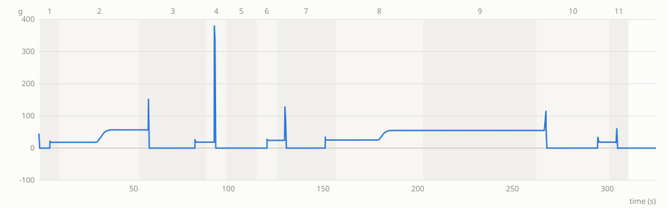

# Lab notebook: run 20261018T004327Z-sim

sim mode · started 2026-10-18T00:43:27Z · finished 2026-10-18T00:43:57Z

| item | value |
|---|---|
| schema | benchsim.runlog/1 |
| layout source | tools/layout/layout_final.json:update13_final |
| bench_params sha256 | `13cf0995af935137d2a95c15c44d7423b8b3ac68769648f3844650d62d943918` |
| SO-101 model revision | `5f6d2b876a53a4872e405b991dd925556c9e38a4` |
| seed | 0 |
| steps passed / failed / skipped | 11 / 0 / 0 |
| faults | 0 |
| video | – |

## Protocol

| item | value |
|---|---|
| source | preset |
| validation | passed |
| approved by | command line |
| approved at | 2026-10-18T00:43:28Z |
| approver | `command line --approve` |
| operator | `command line` |
| plan_sha256 | `3e0a862d79ed4f9aa3441b46b85097a1cb2e523ea0c820da91871d09edcefa87` |
| reason | `pre-approved with --approve; validation passed` |

Protocol text:

> Elephant toothpaste, the standard bench demo. The flask already holds the dish soap and food colouring.
> 
> 1. Put the empty beaker P1 on the scale and pour 39 g of the 12 % hydrogen peroxide developer into it (within 2 g).
> 2. Pour P1 into the flask through the funnel, then put P1 back in the carousel.
> 3. Dose one packet of instant yeast, about 7 g (within 0.7 g, at most two top-ups), into P2 with the auger.
> 4. Bring P2 to the scale and check the yeast weight.
> 5. Add 30 g of warm water on top of the yeast (within 2 g) and let it activate for 60 seconds.
> 6. Pour the yeast slurry into the flask and move the stage to ERUPT as soon as the pourer is clear, then put P2 back in the carousel.

Approved plan:

| # | type | params | label |
|---|---|---|---|
| 1 | `TRANSFER` | beaker=P1, src=carousel_pick, dst=scale_pan | 1 P1 carousel -> scale |
| 2 | `POUR_TO_SCALE` | reagent=developer, beaker=P1, target_g=39.00, tol_g=2.00, relative=no | 2 developer onto P1 |
| 3 | `POUR_TO_FUNNEL` | beaker=P1, erupt=no | 3 P1 -> funnel |
| 4 | `TRANSFER` | beaker=P1, src=scale_pan, dst=carousel_pick | 4 P1 -> carousel |
| 5 | `DOSE_YEAST` | beaker=P2, target_g=7.00, tol_g=0.70, max_topups=2 | 5 yeast dose into P2 |
| 6 | `TRANSFER` | beaker=P2, src=carousel_pick, dst=scale_pan | 6 P2 -> scale |
| 7 | `VERIFY_MASS` | beaker=P2, target_g=7.00, tol_g=0.70 | 6 verify yeast |
| 8 | `POUR_TO_SCALE` | reagent=water, beaker=P2, target_g=30.00, tol_g=2.00, relative=yes | 7 water onto P2 |
| 9 | `WAIT` | seconds=60.00, reason=yeast activation | 7 activate |
| 10 | `POUR_TO_FUNNEL` | beaker=P2, erupt=yes | 8 P2 -> funnel, then ERUPT (reaction starts) |
| 11 | `TRANSFER` | beaker=P2, src=scale_pan, dst=carousel_pick | 9 P2 -> carousel |

## Steps

| # | step | type | status | reason | target | measured | measured − target | start s | end s |
|---|---|---|---|---|---|---|---|---|---|
| 1 | 1 P1 carousel -> scale | `TRANSFER` | passed | grasp grasped |  | grasp_jaw_deg 22.85, scale [{'event': 'place', 'before_g': 0.02, 'after_g': 18.02}], scale_after_g 18.00, beaker_tare_g 18.00 |  | 0.5 | 10.8 |
| 2 | 2 developer onto P1 | `POUR_TO_SCALE` | passed | OK: added 38.64 g (error -0.36) | added_g 39.00, tol_g 2.00 | added_g 38.64, content_g 38.64, outcome OK, theta_first_deg 64.45, theta_cut_deg 77.98, pour_time_s 17.60, topup_pulses 0, grip_h_mm 44.00, spilled_total_g 0.00, sim_truth_receiver_g 38.62 | added_g -0.36 (within ±2.00) | 10.8 | 52.9 |
| 3 | 3 P1 -> funnel | `POUR_TO_FUNNEL` | passed | 0.39 g left in P1 | left_in_beaker_g 0.00, tol_g 2.00 | left_in_beaker_g 0.39, tare measured, sim_truth_delivered_to_flask_g 38.21, sim_truth_poured_from_beaker_g 38.21, spilled_total_g 0.00, profile_time_s 11.50 | left_in_beaker_g +0.39 (within ±2.00) | 52.9 | 88.5 |
| 4 | 4 P1 -> carousel | `TRANSFER` | passed | grasp grasped |  | grasp_jaw_deg 21.88, scale [{'event': 'lift', 'before_g': 18.46, 'after_g': -0.05}] |  | 88.5 | 98.7 |
| 5 | 5 yeast dose into P2 | `DOSE_YEAST` | passed | first pass 7.00 rev; verified on the scale in the next steps | first_pass_rev 7.00, first_pass_g 5.95 | rev_done 7.00, sim_truth_in_beaker_g 6.04, hopper_g 23.95 |  | 98.7 | 115.1 |
| 6 | 6 P2 -> scale | `TRANSFER` | passed | grasp grasped |  | grasp_jaw_deg 22.85, scale [{'event': 'place', 'before_g': -0.0, 'after_g': 24.07}], scale_after_g 24.06 |  | 115.1 | 125.5 |
| 7 | 6 verify yeast | `VERIFY_MASS` | passed | content 7.03 g (error +0.03 g) | content_g 7.00, tol_g 0.70 | scale_g 25.03, tare_g 18.00, tare assumed equal to P1 (18.00 g), content_g 7.03, error_g 0.03, topups 1, auger_passes [{'kind': 'first', 'rev_cmd': 7.0, 'rev_done': 7.0, 'stalls': 0, 't_start': 102.387, 'mass_g': None, 't_end': 110.792}, {'kind': 'topup', 'rev_cmd': 1.1, 'rev_done': 1.1, 'stalls': 0, 't_start': 140.222, 'mass_g': None, 't_end': 141.547}] | content_g +0.03 (within ±0.70) | 125.5 | 156.6 |
| 8 | 7 water onto P2 | `POUR_TO_SCALE` | passed | OK: added 29.69 g (error -0.31) | added_g 30.00, tol_g 2.00 | added_g 29.69, content_g 36.71, outcome OK, theta_first_deg 67.38, theta_cut_deg 78.50, pour_time_s 17.45, topup_pulses 0, grip_h_mm 40.00, spilled_total_g 0.00, sim_truth_receiver_g 36.74 | added_g -0.31 (within ±2.00) | 156.6 | 202.8 |
| 9 | 7 activate | `WAIT` | passed | yeast activation | seconds 60.00 | seconds 60.00 | seconds +0.00 | 202.8 | 262.8 |
| 10 | 8 P2 -> funnel, then ERUPT (reaction starts) | `POUR_TO_FUNNEL` | passed | 0.36 g left in P2 | left_in_beaker_g 0.00, tol_g 2.00 | left_in_beaker_g 0.36, tare assumed = P1, sim_truth_delivered_to_flask_g 36.38, sim_truth_poured_from_beaker_g 36.38, spilled_total_g 0.00, profile_time_s 11.55, erupt_crank_deg 149.40, erupt_done_s 290.69 | left_in_beaker_g +0.36 (within ±2.00) | 262.8 | 301.1 |
| 11 | 9 P2 -> carousel | `TRANSFER` | passed | grasp grasped |  | grasp_jaw_deg 23.03, scale [{'event': 'lift', 'before_g': 19.22, 'after_g': 0.02}] |  | 301.1 | 311.2 |

## Masses

| # | step | quantity | target | measured | difference | tolerance | result |
|---|---|---|---|---|---|---|---|
| 2 | 2 developer onto P1 | added_g | 39.00 | 38.64 | -0.36 | 2.00 | within |
| 3 | 3 P1 -> funnel | left_in_beaker_g | 0.00 | 0.39 | +0.39 | 2.00 | within |
| 7 | 6 verify yeast | content_g | 7.00 | 7.03 | +0.03 | 0.70 | within |
| 8 | 7 water onto P2 | added_g | 30.00 | 29.69 | -0.31 | 2.00 | within |
| 9 | 7 activate | seconds | 60.00 | 60.00 | +0.00 | – | – |
| 10 | 8 P2 -> funnel, then ERUPT (reaction starts) | left_in_beaker_g | 0.00 | 0.36 | +0.36 | 2.00 | within |

Run summary:

| quantity | value |
|---|---|
| vessels | P1 developer 0.42, P2 yeast 0.07, water 0.29, dev developer 21.69, water water 19.89, flask soap 15.45, dye 0.20, developer 38.21, yeast 6.96, water 29.43, hopper yeast 22.98 |
| measured | 1 P1 carousel -> scale grasp_jaw_deg 22.85, scale [{'event': 'place', 'before_g': 0.02, 'after_g': 18.02}], scale_after_g 18.00, beaker_tare_g 18.00, 2 developer onto P1 added_g 38.64, content_g 38.64, outcome OK, theta_first_deg 64.45, theta_cut_deg 77.98, pour_time_s 17.60, topup_pulses 0, grip_h_mm 44.00, spilled_total_g 0.00, sim_truth_receiver_g 38.62, 3 P1 -> funnel left_in_beaker_g 0.39, tare measured, sim_truth_delivered_to_flask_g 38.21, sim_truth_poured_from_beaker_g 38.21, spilled_total_g 0.00, profile_time_s 11.50, 4 P1 -> carousel grasp_jaw_deg 21.88, scale [{'event': 'lift', 'before_g': 18.46, 'after_g': -0.05}], 5 yeast dose into P2 rev_done 7.00, sim_truth_in_beaker_g 6.04, hopper_g 23.95, 6 P2 -> scale grasp_jaw_deg 22.85, scale [{'event': 'place', 'before_g': -0.0, 'after_g': 24.07}], scale_after_g 24.06, 6 verify yeast scale_g 25.03, tare_g 18.00, tare assumed equal to P1 (18.00 g), content_g 7.03, error_g 0.03, topups 1, auger_passes [{'kind': 'first', 'rev_cmd': 7.0, 'rev_done': 7.0, 'stalls': 0, 't_start': 102.387, 'mass_g': None, 't_end': 110.792}, {'kind': 'topup', 'rev_cmd': 1.1, 'rev_done': 1.1, 'stalls': 0, 't_start': 140.222, 'mass_g': None, 't_end': 141.547}], 7 water onto P2 added_g 29.69, content_g 36.71, outcome OK, theta_first_deg 67.38, theta_cut_deg 78.50, pour_time_s 17.45, topup_pulses 0, grip_h_mm 40.00, spilled_total_g 0.00, sim_truth_receiver_g 36.74, 7 activate seconds 60.00, 8 P2 -> funnel, then ERUPT (reaction starts) left_in_beaker_g 0.36, tare assumed = P1, sim_truth_delivered_to_flask_g 36.38, sim_truth_poured_from_beaker_g 36.38, spilled_total_g 0.00, profile_time_s 11.55, erupt_crank_deg 149.40, erupt_done_s 290.69, 9 P2 -> carousel grasp_jaw_deg 23.03, scale [{'event': 'lift', 'before_g': 19.22, 'after_g': 0.02}] |
| spilled_g | 0.00 |
| foam_peak_mm | 200.00 |

## Faults

No faults.

## Scale trace

## Camera frames

missing frame: `frames/0000.00_overview.png`

*start · overview · t 0.00 s*

missing frame: `frames/0000.50_bench_cam.png`

*precheck · bench_cam · t 0.50 s*

missing frame: `frames/0000.50_bench_cam.png`

*before pick P1 · bench_cam · t 0.50 s*

missing frame: `frames/0010.85_bench_cam.png`

*after 1 P1 carousel -> scale · bench_cam · t 10.85 s*

missing frame: `frames/0021.88_overview.png`

*pour start 2 developer onto P1 · overview · t 21.88 s*

missing frame: `frames/0063.39_overview.png`

*funnel pour start 3 P1 -> funnel · overview · t 63.39 s*

missing frame: `frames/0098.66_bench_cam.png`

*after 4 P1 -> carousel · bench_cam · t 98.66 s*

missing frame: `frames/0102.39_bench_cam.png`

*P2 at the auger · bench_cam · t 102.39 s*

missing frame: `frames/0115.09_bench_cam.png`

*before pick P2 · bench_cam · t 115.09 s*

missing frame: `frames/0125.46_bench_cam.png`

*after 6 P2 -> scale · bench_cam · t 125.46 s*

missing frame: `frames/0135.95_bench_cam.png`

*after top-up: back · bench_cam · t 135.95 s*

missing frame: `frames/0145.82_bench_cam.png`

*before pick P2 · bench_cam · t 145.82 s*

missing frame: `frames/0156.19_bench_cam.png`

*after top-up: to scale · bench_cam · t 156.19 s*

missing frame: `frames/0169.69_overview.png`

*pour start 7 water onto P2 · overview · t 169.69 s*

missing frame: `frames/0273.22_overview.png`

*funnel pour start 8 P2 -> funnel, then ERUPT (reaction starts) · overview · t 273.22 s*

missing frame: `frames/0290.69_foam_cam.png`

*stage at ERUPT · foam_cam · t 290.69 s*

missing frame: `frames/0311.20_bench_cam.png`

*after 9 P2 -> carousel · bench_cam · t 311.20 s*

missing frame: `frames/0311.70_foam_cam.png`

*foam t+0.5 s · foam_cam · t 311.70 s*

missing frame: `frames/0313.70_foam_cam.png`

*foam t+2.5 s · foam_cam · t 313.70 s*

missing frame: `frames/0315.70_foam_cam.png`

*foam t+4.5 s · foam_cam · t 315.70 s*

missing frame: `frames/0317.70_foam_cam.png`

*foam t+6.5 s · foam_cam · t 317.70 s*

missing frame: `frames/0319.70_foam_cam.png`

*foam t+8.5 s · foam_cam · t 319.70 s*

missing frame: `frames/0321.70_foam_cam.png`

*foam t+10.5 s · foam_cam · t 321.70 s*

missing frame: `frames/0323.70_foam_cam.png`

*foam t+12.5 s · foam_cam · t 323.70 s*

missing frame: `frames/0325.70_foam_cam.png`

*foam t+14.5 s · foam_cam · t 325.70 s*

## Events

| kind | count |
|---|---|
| step_start | 11 |
| step_done | 11 |
| attach | 10 |
| grasp | 10 |
| detach | 10 |
| release | 10 |
| mega_done | 7 |
| precheck | 1 |
| erupt_done | 1 |

---
Generated by benchsim.notebook at 2026-10-18T00:43:57Z.
