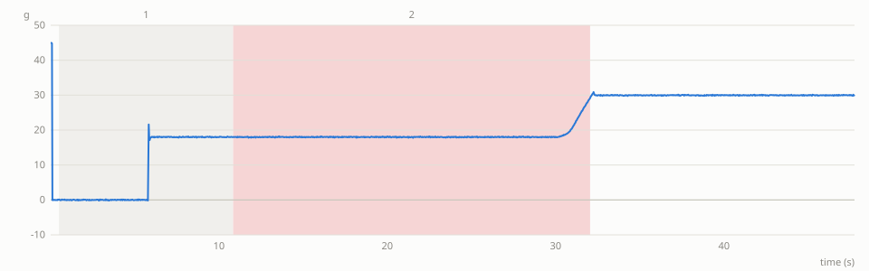

# Lab notebook: run 20261018T004321Z-sim

sim mode · started 2026-10-18T00:43:21Z · finished 2026-10-18T00:43:26Z

| item | value |
|---|---|
| schema | benchsim.runlog/1 |
| layout source | tools/layout/layout_final.json:update13_final |
| bench_params sha256 | `13cf0995af935137d2a95c15c44d7423b8b3ac68769648f3844650d62d943918` |
| SO-101 model revision | `5f6d2b876a53a4872e405b991dd925556c9e38a4` |
| seed | 0 |
| steps passed / failed / skipped | 1 / 1 / 9 |
| faults | 0 |
| video | – |

## Protocol

| item | value |
|---|---|
| source | preset |
| validation | passed |
| approved by | operator (sim, preset) |
| approved at | 2026-10-18T00:43:21Z |

Approved plan:

| # | type | params | label |
|---|---|---|---|
| 1 | `TRANSFER` | beaker=P1, src=carousel_pick, dst=scale_pan | 1 P1 carousel -> scale |
| 2 | `POUR_TO_SCALE` | reagent=developer, beaker=P1, target_g=39.00, tol_g=2.00, relative=no | 2 developer onto P1 |
| 3 | `POUR_TO_FUNNEL` | beaker=P1, erupt=no | 3 P1 -> funnel |
| 4 | `TRANSFER` | beaker=P1, src=scale_pan, dst=carousel_pick | 4 P1 -> carousel |
| 5 | `DOSE_YEAST` | beaker=P2, target_g=7.00, tol_g=0.70, max_topups=2 | 5 yeast dose into P2 |
| 6 | `TRANSFER` | beaker=P2, src=carousel_pick, dst=scale_pan | 6 P2 -> scale |
| 7 | `VERIFY_MASS` | beaker=P2, target_g=7.00, tol_g=0.70 | 6 verify yeast |
| 8 | `POUR_TO_SCALE` | reagent=water, beaker=P2, target_g=30.00, tol_g=2.00, relative=yes | 7 water onto P2 |
| 9 | `WAIT` | seconds=60.00, reason=yeast activation | 7 activate |
| 10 | `POUR_TO_FUNNEL` | beaker=P2, erupt=yes | 8 P2 -> funnel, then ERUPT (reaction starts) |
| 11 | `TRANSFER` | beaker=P2, src=scale_pan, dst=carousel_pick | 9 P2 -> carousel |

## Steps

| # | step | type | status | reason | target | measured | measured − target | start s | end s |
|---|---|---|---|---|---|---|---|---|---|
| 1 | 1 P1 carousel -> scale | `TRANSFER` | passed | grasp grasped |  | grasp_jaw_deg 22.85, scale [{'event': 'place', 'before_g': 0.02, 'after_g': 18.02}], scale_after_g 18.00, beaker_tare_g 18.00 |  | 0.5 | 10.8 |
| 2 | 2 developer onto P1 | `POUR_TO_SCALE` | **failed** | safe stop: operator stop during the developer pour |  |  |  | 10.8 | 32.1 |
| 3 | 3 P1 -> funnel | `POUR_TO_FUNNEL` | **skipped** | not run: safe stop: operator stop during the developer pour |  |  |  | – | – |
| 4 | 4 P1 -> carousel | `TRANSFER` | **skipped** | not run: safe stop: operator stop during the developer pour |  |  |  | – | – |
| 5 | 5 yeast dose into P2 | `DOSE_YEAST` | **skipped** | not run: safe stop: operator stop during the developer pour |  |  |  | – | – |
| 6 | 6 P2 -> scale | `TRANSFER` | **skipped** | not run: safe stop: operator stop during the developer pour |  |  |  | – | – |
| 7 | 6 verify yeast | `VERIFY_MASS` | **skipped** | not run: safe stop: operator stop during the developer pour |  |  |  | – | – |
| 8 | 7 water onto P2 | `POUR_TO_SCALE` | **skipped** | not run: safe stop: operator stop during the developer pour |  |  |  | – | – |
| 9 | 7 activate | `WAIT` | **skipped** | not run: safe stop: operator stop during the developer pour |  |  |  | – | – |
| 10 | 8 P2 -> funnel, then ERUPT (reaction starts) | `POUR_TO_FUNNEL` | **skipped** | not run: safe stop: operator stop during the developer pour |  |  |  | – | – |
| 11 | 9 P2 -> carousel | `TRANSFER` | **skipped** | not run: safe stop: operator stop during the developer pour |  |  |  | – | – |

## Masses

Run summary:

| quantity | value |
|---|---|
| vessels | P1 developer 11.96, P2 , dev developer 48.33, water water 49.60, flask soap 15.45, dye 0.20, hopper yeast 30.00 |
| measured | 1 P1 carousel -> scale grasp_jaw_deg 22.85, scale [{'event': 'place', 'before_g': 0.02, 'after_g': 18.02}], scale_after_g 18.00, beaker_tare_g 18.00 |
| spilled_g | 0.03 |
| foam_peak_mm | 0.00 |

## Faults

No faults.

## Scale trace

## Camera frames

missing frame: `frames/0000.00_overview.png`

*start · overview · t 0.00 s*

missing frame: `frames/0000.50_bench_cam.png`

*precheck · bench_cam · t 0.50 s*

missing frame: `frames/0000.50_bench_cam.png`

*before pick P1 · bench_cam · t 0.50 s*

missing frame: `frames/0010.85_bench_cam.png`

*after 1 P1 carousel -> scale · bench_cam · t 10.85 s*

missing frame: `frames/0021.88_overview.png`

*pour start 2 developer onto P1 · overview · t 21.88 s*

missing frame: `frames/0033.76_foam_cam.png`

*foam t+0.5 s · foam_cam · t 33.76 s*

missing frame: `frames/0035.76_foam_cam.png`

*foam t+2.5 s · foam_cam · t 35.76 s*

missing frame: `frames/0037.76_foam_cam.png`

*foam t+4.5 s · foam_cam · t 37.76 s*

missing frame: `frames/0039.76_foam_cam.png`

*foam t+6.5 s · foam_cam · t 39.76 s*

missing frame: `frames/0041.76_foam_cam.png`

*foam t+8.5 s · foam_cam · t 41.76 s*

missing frame: `frames/0043.76_foam_cam.png`

*foam t+10.5 s · foam_cam · t 43.76 s*

missing frame: `frames/0045.76_foam_cam.png`

*foam t+12.5 s · foam_cam · t 45.76 s*

missing frame: `frames/0047.76_foam_cam.png`

*foam t+14.5 s · foam_cam · t 47.76 s*

## Events

| kind | count |
|---|---|
| step_start | 2 |
| attach | 2 |
| grasp | 2 |
| safe_stop_hold | 2 |
| precheck | 1 |
| detach | 1 |
| release | 1 |
| step_done | 1 |
| stop_requested | 1 |
| safe_stop | 1 |
| safe_stop_untilt | 1 |

---
Generated by benchsim.notebook at 2026-10-18T00:43:26Z.
