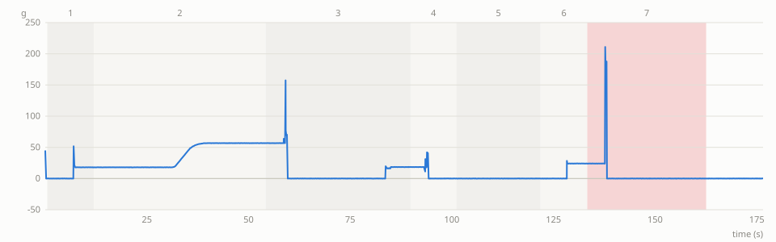
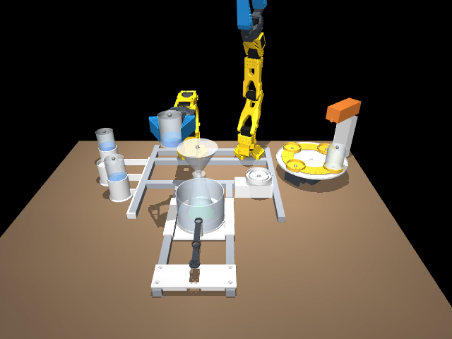
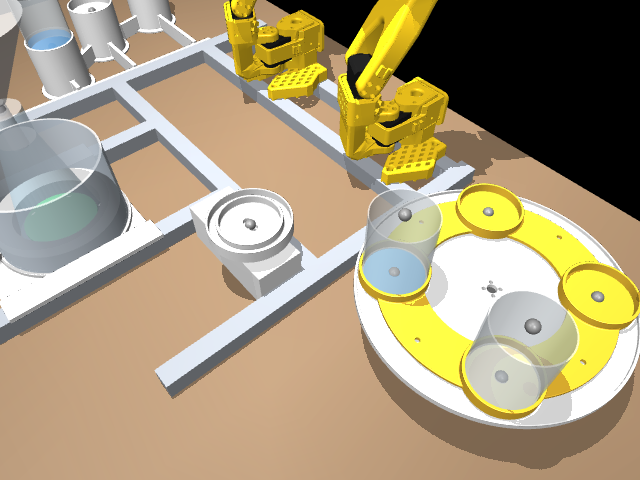
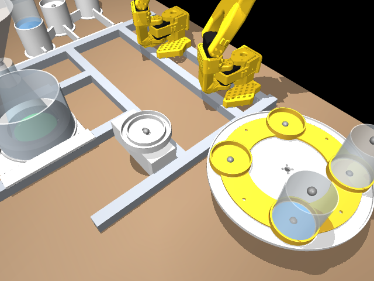
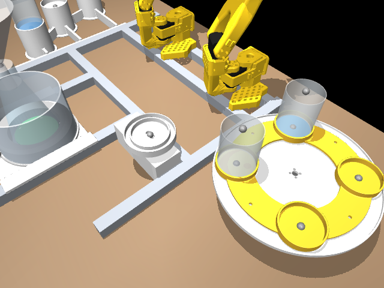
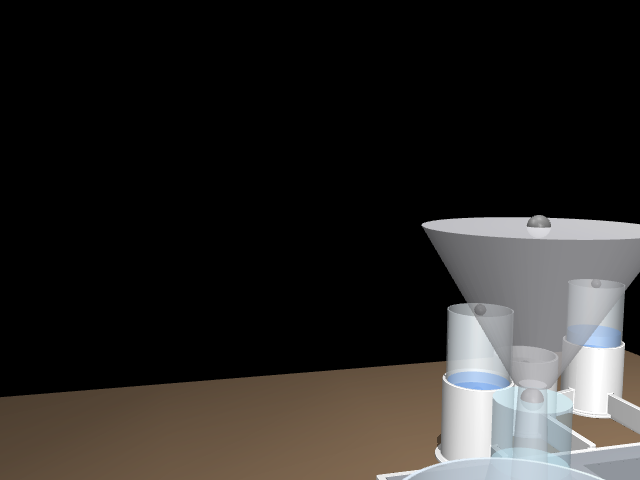

# Lab notebook: run 20261017T052402Z-sim

sim mode · started 2026-10-17T05:24:02Z · finished 2026-10-17T05:24:22Z

| item | value |
|---|---|
| schema | benchsim.runlog/1 |
| layout source | tools/layout/layout_final.json:update13_final |
| bench_params sha256 | `62c630552aa8327f6f60432fb84a5fbf45ce353076f6e634765750a02bea095a` |
| SO-101 model revision | `5f6d2b876a53a4872e405b991dd925556c9e38a4` |
| seed | 0 |
| steps passed / failed / skipped | 6 / 1 / 5 |
| faults | 0 |
| video | – |

## Protocol

| item | value |
|---|---|
| source | preset |
| validation | passed |
| approved by | operator (sim, preset) |
| approved at | 2026-10-17T05:24:02Z |

Approved plan:

| # | type | params | label |
|---|---|---|---|
| 1 | `TRANSFER` | beaker=P1, src=carousel_pick, dst=scale_pan | 1 P1 carousel -> scale |
| 2 | `POUR_TO_SCALE` | reagent=developer, beaker=P1, target_g=39.00, tol_g=2.00, relative=no | 2 developer onto P1 |
| 3 | `POUR_TO_FUNNEL` | beaker=P1 | 3 P1 -> funnel |
| 4 | `TRANSFER` | beaker=P1, src=scale_pan, dst=carousel_pick | 4 P1 -> carousel |
| 5 | `DOSE_YEAST` | beaker=P2, target_g=7.00, tol_g=0.70, max_topups=2 | 5 yeast dose into P2 |
| 6 | `TRANSFER` | beaker=P2, src=carousel_pick, dst=scale_pan | 6 P2 -> scale |
| 7 | `VERIFY_MASS` | beaker=P2, target_g=7.00, tol_g=0.70 | 6 verify yeast |
| 8 | `POUR_TO_SCALE` | reagent=water, beaker=P2, target_g=30.00, tol_g=2.00, relative=yes | 7 water onto P2 |
| 9 | `WAIT` | seconds=60.00, reason=yeast activation | 7 activate |
| 10 | `POUR_TO_FUNNEL` | beaker=P2 | 8 P2 -> funnel (reaction starts) |
| 11 | `TRANSFER` | beaker=P2, src=scale_pan, dst=carousel_pick | 9 P2 -> carousel |
| 12 | `STAGE` | position=ERUPT | 10 ERUPT |

## Steps

| # | step | type | status | reason | target | measured | measured − target | start s | end s |
|---|---|---|---|---|---|---|---|---|---|
| 1 | 1 P1 carousel -> scale | `TRANSFER` | passed | grasp grasped |  | grasp_jaw_deg 23.12, scale [{'event': 'place', 'before_g': 0.04, 'after_g': 18.03}], scale_after_g 17.98, beaker_tare_g 17.98 |  | 0.5 | 12.0 |
| 2 | 2 developer onto P1 | `POUR_TO_SCALE` | passed | OK: added 38.71 g (error -0.29) | added_g 39.00, tol_g 2.00 | added_g 38.71, content_g 38.71, outcome OK, theta_first_deg 64.53, theta_cut_deg 78.06, pour_time_s 17.70, topup_pulses 0, grip_h_mm 44.00, spilled_total_g 0.00, sim_truth_receiver_g 38.73 | added_g -0.29 (within ±2.00) | 12.0 | 54.2 |
| 3 | 3 P1 -> funnel | `POUR_TO_FUNNEL` | passed | 0.46 g left in P1 | left_in_beaker_g 0.00, tol_g 2.00 | left_in_beaker_g 0.46, tare measured, sim_truth_delivered_to_flask_g 38.32, sim_truth_poured_from_beaker_g 38.32, spilled_total_g 0.00, profile_time_s 11.50 | left_in_beaker_g +0.46 (within ±2.00) | 54.2 | 89.9 |
| 4 | 4 P1 -> carousel | `TRANSFER` | passed | grasp grasped |  | grasp_jaw_deg 22.85, scale [{'event': 'lift', 'before_g': 18.7, 'after_g': 0.04}] |  | 89.9 | 101.1 |
| 5 | 5 yeast dose into P2 | `DOSE_YEAST` | passed | first pass 7.00 rev; verified on the scale in the next steps | first_pass_rev 7.00, first_pass_g 5.95 | rev_done 7.00, sim_truth_in_beaker_g 6.04, hopper_g 23.95 |  | 101.1 | 121.8 |
| 6 | 6 P2 -> scale | `TRANSFER` | passed | grasp grasped |  | grasp_jaw_deg 23.03, scale [{'event': 'place', 'before_g': 0.01, 'after_g': 24.06}], scale_after_g 24.04 |  | 121.8 | 133.3 |
| 7 | 6 verify yeast | `VERIFY_MASS` | **failed** | safe stop: step timeout |  |  |  | 133.3 | 162.6 |
| 8 | 7 water onto P2 | `POUR_TO_SCALE` | **skipped** | not run: safe stop: step timeout |  |  |  | – | – |
| 9 | 7 activate | `WAIT` | **skipped** | not run: safe stop: step timeout |  |  |  | – | – |
| 10 | 8 P2 -> funnel (reaction starts) | `POUR_TO_FUNNEL` | **skipped** | not run: safe stop: step timeout |  |  |  | – | – |
| 11 | 9 P2 -> carousel | `TRANSFER` | **skipped** | not run: safe stop: step timeout |  |  |  | – | – |
| 12 | 10 ERUPT | `STAGE` | **skipped** | not run: safe stop: step timeout |  |  |  | – | – |

## Masses

| # | step | quantity | target | measured | difference | tolerance | result |
|---|---|---|---|---|---|---|---|
| 2 | 2 developer onto P1 | added_g | 39.00 | 38.71 | -0.29 | 2.00 | within |
| 3 | 3 P1 -> funnel | left_in_beaker_g | 0.00 | 0.46 | +0.46 | 2.00 | within |

Run summary:

| quantity | value |
|---|---|
| vessels | P1 developer 0.42, P2 yeast 6.81, dev developer 21.59, water water 49.60, flask soap 15.45, dye 0.20, developer 38.32, hopper yeast 23.19 |
| measured | 1 P1 carousel -> scale grasp_jaw_deg 23.12, scale [{'event': 'place', 'before_g': 0.04, 'after_g': 18.03}], scale_after_g 17.98, beaker_tare_g 17.98, 2 developer onto P1 added_g 38.71, content_g 38.71, outcome OK, theta_first_deg 64.53, theta_cut_deg 78.06, pour_time_s 17.70, topup_pulses 0, grip_h_mm 44.00, spilled_total_g 0.00, sim_truth_receiver_g 38.73, 3 P1 -> funnel left_in_beaker_g 0.46, tare measured, sim_truth_delivered_to_flask_g 38.32, sim_truth_poured_from_beaker_g 38.32, spilled_total_g 0.00, profile_time_s 11.50, 4 P1 -> carousel grasp_jaw_deg 22.85, scale [{'event': 'lift', 'before_g': 18.7, 'after_g': 0.04}], 5 yeast dose into P2 rev_done 7.00, sim_truth_in_beaker_g 6.04, hopper_g 23.95, 6 P2 -> scale grasp_jaw_deg 23.03, scale [{'event': 'place', 'before_g': 0.01, 'after_g': 24.06}], scale_after_g 24.04 |
| spilled_g | 0.00 |
| foam_peak_mm | 0.00 |

## Faults

No faults.

## Scale trace

## Camera frames

*start · overview · t 0.00 s*

*precheck · bench_cam · t 0.50 s*

*before pick P1 · bench_cam · t 0.50 s*

*after 1 P1 carousel -> scale · bench_cam · t 11.96 s*

*pour start 2 developer onto P1 · overview · t 22.99 s*

*funnel pour start 3 P1 -> funnel · overview · t 64.69 s*

*after 4 P1 -> carousel · bench_cam · t 101.09 s*

*P2 at the auger · bench_cam · t 105.10 s*

*before pick P2 · bench_cam · t 121.81 s*

*after 6 P2 -> scale · bench_cam · t 133.32 s*

*after top-up: back · bench_cam · t 144.91 s*

*before pick P2 · bench_cam · t 162.54 s*

*foam t+2.0 s · foam_cam · t 164.57 s*

*foam t+4.0 s · foam_cam · t 166.57 s*

*foam t+6.0 s · foam_cam · t 168.57 s*

*foam t+8.0 s · foam_cam · t 170.57 s*

*foam t+10.0 s · foam_cam · t 172.57 s*

*foam t+12.0 s · foam_cam · t 174.57 s*

*foam t+14.0 s · foam_cam · t 176.57 s*

## Events

| kind | count |
|---|---|
| step_start | 7 |
| attach | 6 |
| grasp | 6 |
| detach | 6 |
| release | 6 |
| step_done | 6 |
| mega_done | 6 |
| safe_stop_hold | 2 |
| precheck | 1 |
| stop_requested | 1 |
| safe_stop | 1 |

---
Generated by benchsim.notebook at 2026-10-17T05:24:22Z.
