# Lab notebook: run 20261017T052814Z-sim

sim mode · started 2026-10-17T05:28:14Z · finished 2026-10-17T05:28:52Z

| item | value |
|---|---|
| schema | benchsim.runlog/1 |
| layout source | tools/layout/layout_final.json:update13_final |
| bench_params sha256 | `62c630552aa8327f6f60432fb84a5fbf45ce353076f6e634765750a02bea095a` |
| SO-101 model revision | `5f6d2b876a53a4872e405b991dd925556c9e38a4` |
| seed | 0 |
| steps passed / failed / skipped | 12 / 0 / 0 |
| faults | 0 |
| video | – |

## Protocol

| item | value |
|---|---|
| source | preset |
| validation | passed |
| approved by | command line |
| approved at | 2026-10-17T05:28:14Z |
| approver | `command line --approve` |
| operator | `command line` |
| plan_sha256 | `0e62c7f158946fcdf69214f5fa86649e85280178cb555c4af69ee209b3706423` |
| reason | `pre-approved with --approve; validation passed` |

Protocol text:

> Elephant toothpaste, the standard bench demo. The flask already holds the dish soap and food colouring.
> 
> 1. Put the empty beaker P1 on the scale and pour 39 g of the 12 % hydrogen peroxide developer into it (within 2 g).
> 2. Pour P1 into the flask through the funnel, then put P1 back in the carousel.
> 3. Dose one packet of instant yeast, about 7 g (within 0.7 g, at most two top-ups), into P2 with the auger.
> 4. Bring P2 to the scale and check the yeast weight.
> 5. Add 30 g of warm water on top of the yeast (within 2 g) and let it activate for 60 seconds.
> 6. Pour the yeast slurry into the flask, put P2 back in the carousel, then move the stage to ERUPT.

Approved plan:

| # | type | params | label |
|---|---|---|---|
| 1 | `TRANSFER` | beaker=P1, src=carousel_pick, dst=scale_pan | 1 P1 carousel -> scale |
| 2 | `POUR_TO_SCALE` | reagent=developer, beaker=P1, target_g=39.00, tol_g=2.00, relative=no | 2 developer onto P1 |
| 3 | `POUR_TO_FUNNEL` | beaker=P1 | 3 P1 -> funnel |
| 4 | `TRANSFER` | beaker=P1, src=scale_pan, dst=carousel_pick | 4 P1 -> carousel |
| 5 | `DOSE_YEAST` | beaker=P2, target_g=7.00, tol_g=0.70, max_topups=2 | 5 yeast dose into P2 |
| 6 | `TRANSFER` | beaker=P2, src=carousel_pick, dst=scale_pan | 6 P2 -> scale |
| 7 | `VERIFY_MASS` | beaker=P2, target_g=7.00, tol_g=0.70 | 6 verify yeast |
| 8 | `POUR_TO_SCALE` | reagent=water, beaker=P2, target_g=30.00, tol_g=2.00, relative=yes | 7 water onto P2 |
| 9 | `WAIT` | seconds=60.00, reason=yeast activation | 7 activate |
| 10 | `POUR_TO_FUNNEL` | beaker=P2 | 8 P2 -> funnel (reaction starts) |
| 11 | `TRANSFER` | beaker=P2, src=scale_pan, dst=carousel_pick | 9 P2 -> carousel |
| 12 | `STAGE` | position=ERUPT | 10 ERUPT |

## Steps

| # | step | type | status | reason | target | measured | measured − target | start s | end s |
|---|---|---|---|---|---|---|---|---|---|
| 1 | 1 P1 carousel -> scale | `TRANSFER` | passed | grasp grasped |  | grasp_jaw_deg 23.12, scale [{'event': 'place', 'before_g': 0.04, 'after_g': 18.03}], scale_after_g 17.98, beaker_tare_g 17.98 |  | 0.5 | 12.0 |
| 2 | 2 developer onto P1 | `POUR_TO_SCALE` | passed | OK: added 38.71 g (error -0.29) | added_g 39.00, tol_g 2.00 | added_g 38.71, content_g 38.71, outcome OK, theta_first_deg 64.53, theta_cut_deg 78.06, pour_time_s 17.70, topup_pulses 0, grip_h_mm 44.00, spilled_total_g 0.00, sim_truth_receiver_g 38.73 | added_g -0.29 (within ±2.00) | 12.0 | 54.2 |
| 3 | 3 P1 -> funnel | `POUR_TO_FUNNEL` | passed | 0.46 g left in P1 | left_in_beaker_g 0.00, tol_g 2.00 | left_in_beaker_g 0.46, tare measured, sim_truth_delivered_to_flask_g 38.32, sim_truth_poured_from_beaker_g 38.32, spilled_total_g 0.00, profile_time_s 11.50 | left_in_beaker_g +0.46 (within ±2.00) | 54.2 | 89.9 |
| 4 | 4 P1 -> carousel | `TRANSFER` | passed | grasp grasped |  | grasp_jaw_deg 22.85, scale [{'event': 'lift', 'before_g': 18.7, 'after_g': 0.04}] |  | 89.9 | 101.1 |
| 5 | 5 yeast dose into P2 | `DOSE_YEAST` | passed | first pass 7.00 rev; verified on the scale in the next steps | first_pass_rev 7.00, first_pass_g 5.95 | rev_done 7.00, sim_truth_in_beaker_g 6.04, hopper_g 23.95 |  | 101.1 | 121.8 |
| 6 | 6 P2 -> scale | `TRANSFER` | passed | grasp grasped |  | grasp_jaw_deg 23.03, scale [{'event': 'place', 'before_g': 0.01, 'after_g': 24.06}], scale_after_g 24.04 |  | 121.8 | 133.3 |
| 7 | 6 verify yeast | `VERIFY_MASS` | passed | content 6.85 g (error -0.15 g) | content_g 7.00, tol_g 0.70 | scale_g 24.83, tare_g 17.98, tare assumed equal to P1 (17.98 g), content_g 6.85, error_g -0.15, topups 1, auger_passes [{'kind': 'first', 'rev_cmd': 7.0, 'rev_done': 7.0, 'stalls': 0, 't_start': 105.1, 'mass_g': None, 't_end': 113.805}, {'kind': 'topup', 'rev_cmd': 1.1, 'rev_done': 1.1, 'stalls': 0, 't_start': 152.915, 'mass_g': None, 't_end': 154.54}] | content_g -0.15 (within ±0.70) | 133.3 | 174.4 |
| 8 | 7 water onto P2 | `POUR_TO_SCALE` | passed | OK: added 29.77 g (error -0.23) | added_g 30.00, tol_g 2.00 | added_g 29.77, content_g 36.62, outcome OK, theta_first_deg 67.30, theta_cut_deg 78.52, pour_time_s 17.50, topup_pulses 0, grip_h_mm 40.00, spilled_total_g 0.00, sim_truth_receiver_g 36.57 | added_g -0.23 (within ±2.00) | 174.4 | 220.4 |
| 9 | 7 activate | `WAIT` | passed | yeast activation | seconds 60.00 | seconds 60.00 | seconds +0.00 | 220.4 | 280.4 |
| 10 | 8 P2 -> funnel (reaction starts) | `POUR_TO_FUNNEL` | passed | 0.39 g left in P2 | left_in_beaker_g 0.00, tol_g 2.00 | left_in_beaker_g 0.39, tare assumed = P1, sim_truth_delivered_to_flask_g 36.21, sim_truth_poured_from_beaker_g 36.21, spilled_total_g 0.00, profile_time_s 11.55 | left_in_beaker_g +0.39 (within ±2.00) | 280.4 | 316.1 |
| 11 | 9 P2 -> carousel | `TRANSFER` | passed | grasp grasped |  | grasp_jaw_deg 22.94, scale [{'event': 'lift', 'before_g': 18.29, 'after_g': -0.05}] |  | 316.1 | 327.3 |
| 12 | 10 ERUPT | `STAGE` | passed | stage at ERUPT | crank_deg 150.00 | crank_deg 149.40 | crank_deg -0.60 | 327.3 | 330.0 |

## Masses

| # | step | quantity | target | measured | difference | tolerance | result |
|---|---|---|---|---|---|---|---|
| 2 | 2 developer onto P1 | added_g | 39.00 | 38.71 | -0.29 | 2.00 | within |
| 3 | 3 P1 -> funnel | left_in_beaker_g | 0.00 | 0.46 | +0.46 | 2.00 | within |
| 7 | 6 verify yeast | content_g | 7.00 | 6.85 | -0.15 | 0.70 | within |
| 8 | 7 water onto P2 | added_g | 30.00 | 29.77 | -0.23 | 2.00 | within |
| 9 | 7 activate | seconds | 60.00 | 60.00 | +0.00 | – | – |
| 10 | 8 P2 -> funnel (reaction starts) | left_in_beaker_g | 0.00 | 0.39 | +0.39 | 2.00 | within |
| 12 | 10 ERUPT | crank_deg | 150.00 | 149.40 | -0.60 | – | – |

Run summary:

| quantity | value |
|---|---|
| vessels | P1 developer 0.42, P2 yeast 0.07, water 0.29, dev developer 21.59, water water 19.84, flask soap 15.45, dye 0.20, developer 38.32, yeast 6.74, water 29.47, hopper yeast 23.19 |
| measured | 1 P1 carousel -> scale grasp_jaw_deg 23.12, scale [{'event': 'place', 'before_g': 0.04, 'after_g': 18.03}], scale_after_g 17.98, beaker_tare_g 17.98, 2 developer onto P1 added_g 38.71, content_g 38.71, outcome OK, theta_first_deg 64.53, theta_cut_deg 78.06, pour_time_s 17.70, topup_pulses 0, grip_h_mm 44.00, spilled_total_g 0.00, sim_truth_receiver_g 38.73, 3 P1 -> funnel left_in_beaker_g 0.46, tare measured, sim_truth_delivered_to_flask_g 38.32, sim_truth_poured_from_beaker_g 38.32, spilled_total_g 0.00, profile_time_s 11.50, 4 P1 -> carousel grasp_jaw_deg 22.85, scale [{'event': 'lift', 'before_g': 18.7, 'after_g': 0.04}], 5 yeast dose into P2 rev_done 7.00, sim_truth_in_beaker_g 6.04, hopper_g 23.95, 6 P2 -> scale grasp_jaw_deg 23.03, scale [{'event': 'place', 'before_g': 0.01, 'after_g': 24.06}], scale_after_g 24.04, 6 verify yeast scale_g 24.83, tare_g 17.98, tare assumed equal to P1 (17.98 g), content_g 6.85, error_g -0.15, topups 1, auger_passes [{'kind': 'first', 'rev_cmd': 7.0, 'rev_done': 7.0, 'stalls': 0, 't_start': 105.1, 'mass_g': None, 't_end': 113.805}, {'kind': 'topup', 'rev_cmd': 1.1, 'rev_done': 1.1, 'stalls': 0, 't_start': 152.915, 'mass_g': None, 't_end': 154.54}], 7 water onto P2 added_g 29.77, content_g 36.62, outcome OK, theta_first_deg 67.30, theta_cut_deg 78.52, pour_time_s 17.50, topup_pulses 0, grip_h_mm 40.00, spilled_total_g 0.00, sim_truth_receiver_g 36.57, 7 activate seconds 60.00, 8 P2 -> funnel (reaction starts) left_in_beaker_g 0.39, tare assumed = P1, sim_truth_delivered_to_flask_g 36.21, sim_truth_poured_from_beaker_g 36.21, spilled_total_g 0.00, profile_time_s 11.55, 9 P2 -> carousel grasp_jaw_deg 22.94, scale [{'event': 'lift', 'before_g': 18.29, 'after_g': -0.05}], 10 ERUPT crank_deg 149.40 |
| spilled_g | 0.00 |
| foam_peak_mm | 200.00 |

## Faults

No faults.

## Scale trace

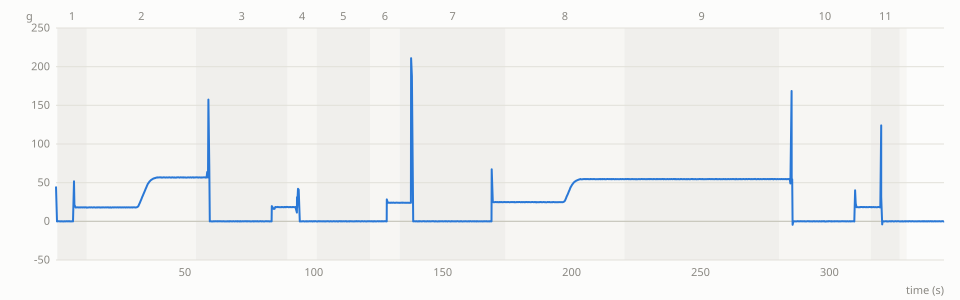

## Camera frames

*start · overview · t 0.00 s*

*precheck · bench_cam · t 0.50 s*

*before pick P1 · bench_cam · t 0.50 s*

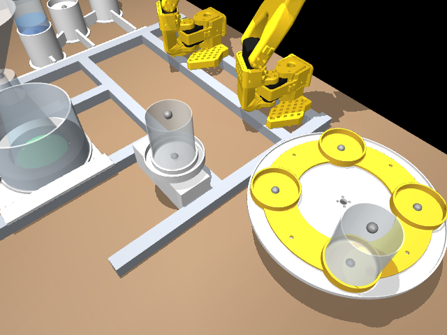

*after 1 P1 carousel -> scale · bench_cam · t 11.96 s*

*pour start 2 developer onto P1 · overview · t 22.99 s*

*funnel pour start 3 P1 -> funnel · overview · t 64.69 s*

*after 4 P1 -> carousel · bench_cam · t 101.09 s*

*P2 at the auger · bench_cam · t 105.10 s*

*before pick P2 · bench_cam · t 121.81 s*

*after 6 P2 -> scale · bench_cam · t 133.32 s*

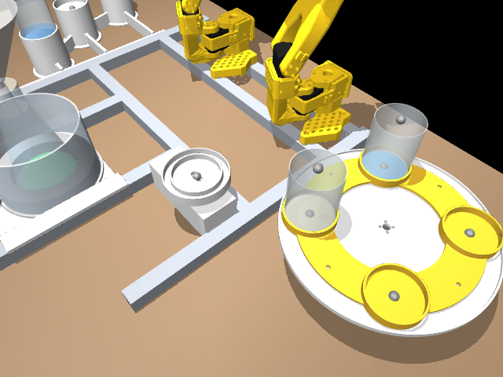

*after top-up: back · bench_cam · t 144.91 s*

*before pick P2 · bench_cam · t 162.54 s*

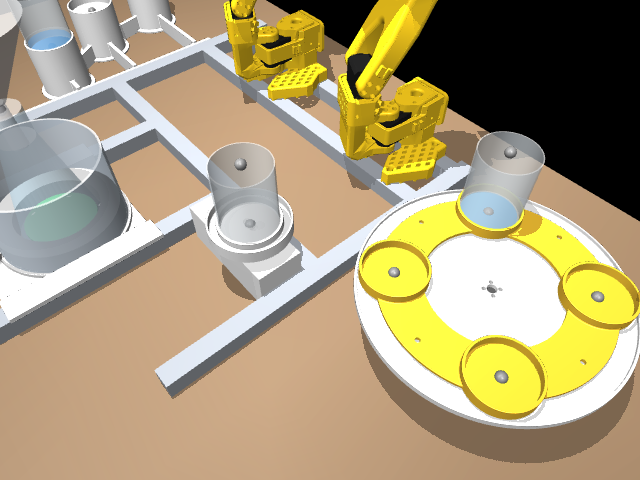

*after top-up: to scale · bench_cam · t 174.00 s*

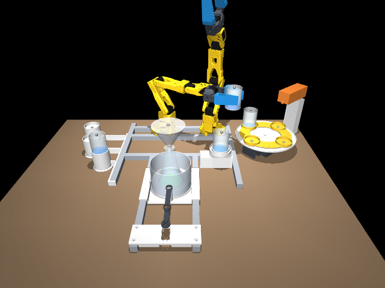

*pour start 7 water onto P2 · overview · t 187.47 s*

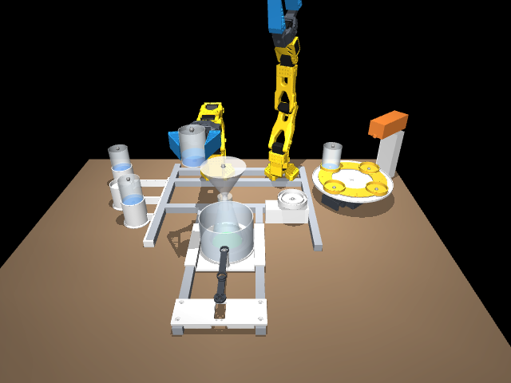

*funnel pour start 8 P2 -> funnel (reaction starts) · overview · t 290.89 s*

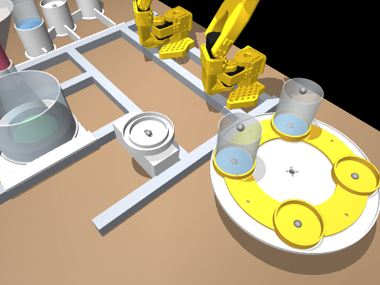

*after 9 P2 -> carousel · bench_cam · t 327.32 s*

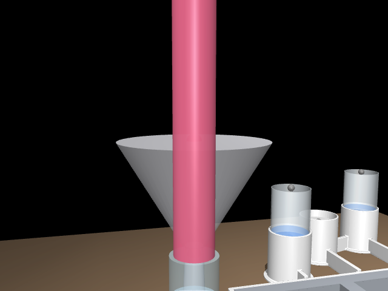

*stage at ERUPT · foam_cam · t 330.00 s*

*foam t+0.5 s · foam_cam · t 330.50 s*

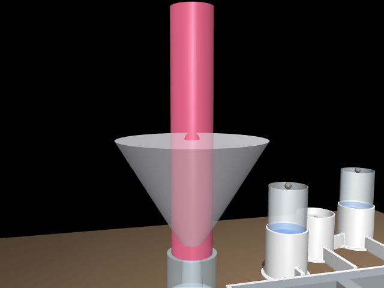

*foam t+2.5 s · foam_cam · t 332.50 s*

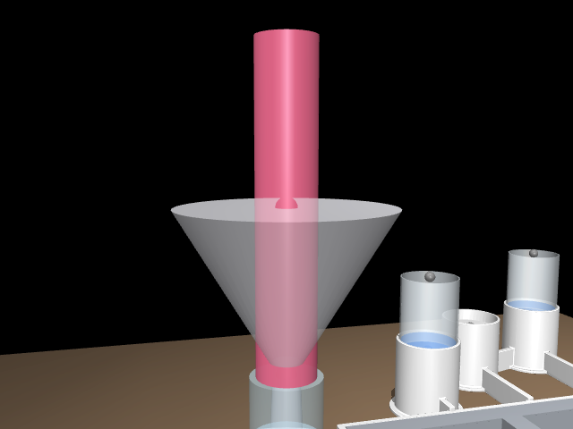

*foam t+4.5 s · foam_cam · t 334.50 s*

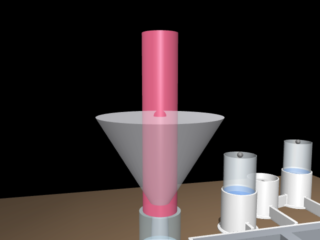

*foam t+6.5 s · foam_cam · t 336.50 s*

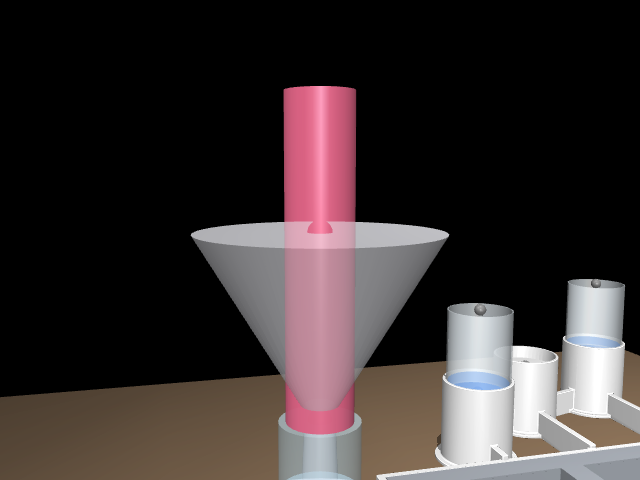

*foam t+8.5 s · foam_cam · t 338.50 s*

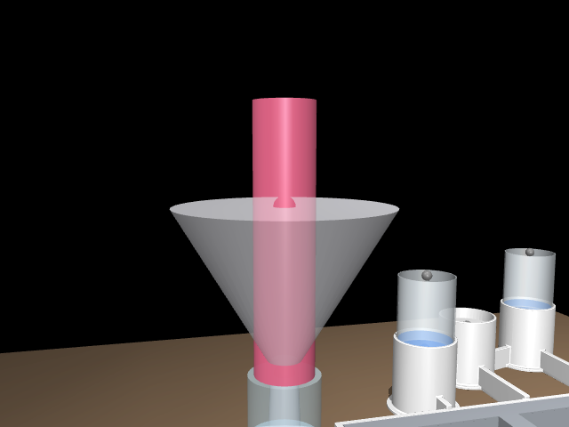

*foam t+10.5 s · foam_cam · t 340.50 s*

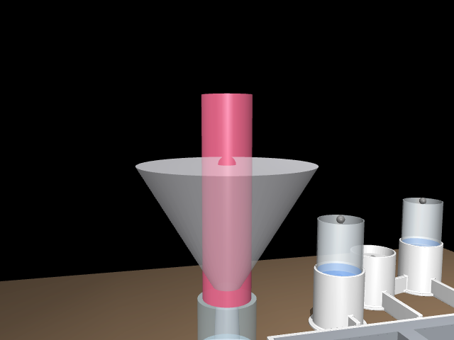

*foam t+12.5 s · foam_cam · t 342.50 s*

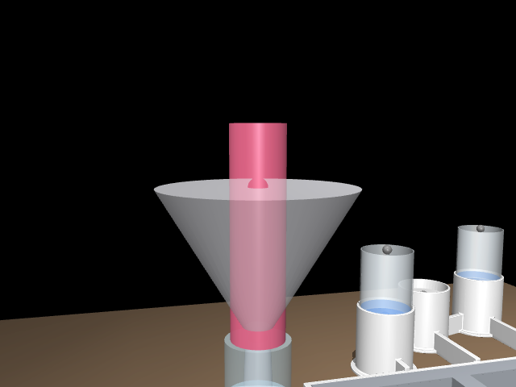

*foam t+14.5 s · foam_cam · t 344.50 s*

## Events

| kind | count |
|---|---|
| step_start | 12 |
| step_done | 12 |
| attach | 10 |
| grasp | 10 |
| detach | 10 |
| release | 10 |
| mega_done | 7 |
| precheck | 1 |

---
Generated by benchsim.notebook at 2026-10-17T05:28:52Z.
